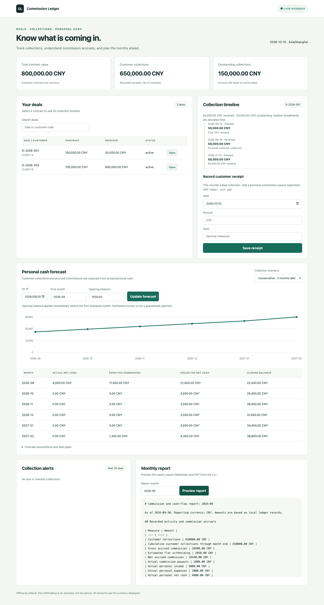

# Commission Cashflow Ledger

An offline ledger for commission-based work. Track contracts and customer collections, calculate traceable commissions, and forecast personal cash flow without treating accrued commissions as money already received.

Python 3.11+ · SQLite · CLI · MCP stdio · local Web dashboard · MIT



## Install

```bash
git clone https://github.com/GuoHaoyu1688/commission-cashflow-ledger.git
cd commission-cashflow-ledger
python3 -m venv .venv
. .venv/bin/activate
python -m pip install -e .
```

Dependencies are downloaded during installation. All application operations then run locally, with no API keys, cloud services, bank connections, telemetry, or runtime network calls. The dashboard binds to loopback only.

## Three-command quick start

After installation, run these from the repository root. All included contracts and customers are fictional; the fixed reporting date makes the example reproducible.

```bash
ledger --config examples/config.yaml import examples/ledger.json --json
ledger --config examples/config.yaml commission calc --month 2026-09 --json
ledger --config examples/config.yaml report --month 2026-09 --as-of 2026-09-30 --pdf --json
```

The import inserts 13 records and safely skips them on a repeat run. Reports appear in `data/demo/reports/2026-09.md`, a four-page PDF, and three PNG charts. Expected September figures:

| Measure | CNY |
| --- | ---: |
| Customer collections | 650,000.00 |
| Gross commission accrual | 20,500.00 |
| Flat withholding estimate (10%) | 2,050.00 |
| Net commission accrual | 18,450.00 |
| Actual commission payout | 1,000.00 |
| Other actual personal income | 5,000.00 |
| Actual personal expenses | 2,000.00 |
| Actual personal net cash | 4,000.00 |

The arithmetic is `50,000 × 3% + 500,000 × 3% + 100,000 × 4% = 20,500`. Net accrual is `20,500 − 2,050 = 18,450`. Personal net cash is `1,000 + 5,000 − 2,000 = 4,000`. The tests assert these figures independently.

Start the dashboard:

```bash
ledger --config examples/config.yaml serve --port 8767
```

Open `http://127.0.0.1:8767`. Browse or search deals, inspect installment and receipt timelines, record a receipt, compare forecast scenarios, and preview monthly reports. Use **As of 2026-09-30**, **First month 2026-09**, and **Opening balance 1000** to reproduce the sample forecast. Responsive desktop and phone layouts use local HTML/CSS/JS with no build step or CDN. The JSON API schema is available at `/openapi.json`; no external documentation assets load.

## Commission rules

The first invocation creates `data/ledger.db` and `data/rules.yaml`. Rules are read afresh on every calculation. The engine supports receipt or contract basis, progressive tiers, per-deal overrides, a lifetime floor/cap, configurable estimated withholding, and a whole-month payout delay.

```yaml
version: 1
default:
  basis: receipts
  rate: '0.03'
  withholding_rate: '0'
  payout_delay_months: 0
  floor: '0'
  cap: null
overrides:
  D-2026-002:
    tiers:
      - up_to: '500000'
        rate: '0.03'
      - up_to: null
        rate: '0.04'
  D-2026-003:
    basis: contract
    rate: '0.02'
    cap: '5000'
```

Rates are fractions (`0.03` means 3%). Quote money and rates in YAML. The final tier must be unlimited (`up_to: null`). Override values inherit defaults; a per-deal `rate` replaces inherited tiers. A deal's `override_rate` takes precedence over YAML tiers/rates, retaining the basis, floor, cap, and withholding settings.

**Calculation conventions are explicit:**

- Tiers, floor, and cap apply to each deal's lifetime cumulative basis, in its own currency. Tiers are progressive, never retroactive flat rates. A 700,000 collection earns `500,000 × 3% + 200,000 × 4% = 23,000`.
- Gross cumulative commission rounds to cents using `ROUND_HALF_UP`, then applies floor/cap. Estimated cumulative withholding also rounds half up. Each receipt's accrual is the difference between consecutive cumulative totals, so split receipts reconcile exactly.
- Two 100,000 receipts at 3% with a 5,000 lifetime cap earn 3,000 then 2,000. A 500 lifetime floor with collections of 5,000, 5,000, and 20,000 earns 500, 0, and 400. A zero cumulative basis earns zero, including after a full reversal.
- At 3%, two receipts of 0.50 earn 0.02 then 0.01, totaling 0.03. The floor applies as soon as the basis becomes positive; it is not a guaranteed payment.
- Contract-basis commission accrues once on the signature date for signed/active/settled deals. Receipt-basis commission follows actual collections. Negotiating/cancelled contracts do not create contract-basis accruals or future collection forecasts. Existing receipt-basis accruals remain visible after cancellation.
- Receipts cannot be future-dated or exceed the contract's lifetime net amount at any chronological point. Overpayments are rejected; no silent clipping occurs. A reversal creates a linked negative receipt, never edits history, cannot predate or exceed the unreversed original, and requires `--yes`. Reversals recalculate negative commission deltas; they never reverse an actual personal payout automatically.

Every saved accrual carries a receipt/contract reference, effective rate, currency, cumulative basis, normalized rule, and SHA-256 rule snapshot. SQLite preserves the YAML snapshot and calculation differences. `commission calc --month` recalculates all history atomically, then filters the returned month. Read-only `--dry-run` previews changes. Editing rules restates history intentionally; old snapshots and before/after amounts remain in `commission history`. Back up before changes.

See the [Python Decimal reference](https://docs.python.org/3/library/decimal.html) for exact decimal arithmetic and rounding semantics. The commission rules themselves are configurable product assumptions, not statutory formulas.

## Personal cash and forecast assumptions

**Customer receipts, accrued commissions, and personal cash are three separate records.** Use `receipt add` for a customer collection. Use `cash add --kind income --category commission --deal CODE` for an actual personal commission payout. Other actual cash income and expenses use `cash add` with a category. Recurring records are schedules, not evidence of payment.

Forecasts default to six months. Optimistic/base/conservative scenarios delay remaining planned collections by 0/1/3 calendar months. Customer receipts are allocated FIFO to the earliest installments; a reversal reopens those installment balances. There is no invoice-specific receipt allocation in v0.1.0.

Unpaid net accrual is expected at the later of the as-of date or the last accrual date plus the configured payout delay. Future collection-based commission follows the delayed collection date plus payout delay. Payouts exceeding current accrual generate a warning and offset subsequent planned commissions; no automatic cash clawback occurs. Unplanned contract balances are reported as data gaps and excluded from collection-based forecasts.

Recurring schedules support monthly, quarterly, and once. Dates retain their original day, clamped at month end (January 31 → February 28 → March 31). Link recorded cash to `--recurring-id` in the occurrence month to reduce that month's estimate. Unpaid current-month schedules roll forward to the as-of date; past months show recorded cash only. Cross-month recurring settlements require a manual schedule adjustment. Schedules do not auto-create cash records.

Opening balance means the balance **immediately before the first displayed month**, not today's balance. Historical months use recorded cash; the current/future months add estimates. As-of filtering uses transaction dates, not a reconstruction of when the information was first known. Forecasts are planning assumptions, not guaranteed payment dates or investment/tax advice.

## CLI reference

All commands are noninteractive. Global flags may appear before or after the command: `--data-dir DIR`, `--config YAML`, `--json`, `--quiet`, `--progress`, `--version`. Small queries return one JSON object. `--progress` logs to stderr; the first chart render may take longer while Matplotlib initializes its font cache.

| Command | Main arguments |
| --- | --- |
| `init` | Initialize the database and rules |
| `deal add` | `--code --client-code --signed-date --amount [--currency CNY] [--status signed] [--tag TAG] [--override-rate 0.04]` |
| `deal list` / `deal show CODE` | Show deals / installment allocation and receipt timeline; show accepts `--as-of` |
| `deal update CODE` | `--status active`, `--override-rate 0.04`, or `--clear-override` |
| `plan add` | `--deal CODE --due-date DATE` and either `--amount` or `--proportion 0.5` |
| `receipt add` | `--deal CODE --date DATE --amount MONEY [--note TEXT] [--idempotency-key KEY]` |
| `receipt reverse ID` | `--date DATE [--amount MONEY] --yes`; omit amount for remaining full reversal |
| `commission calc` | `[--month YYYY-MM] [--dry-run]` |
| `commission history` | Stored before/after recalculation differences |
| `recurring add` / `recurring list` | `--name --kind income\|expense --amount --freq monthly\|quarterly\|once --start [--end] [--currency]` |
| `cash add` / `cash list` | `--date --kind income\|expense --amount [--currency] [--category] [--note] [--deal] [--recurring-id]` |
| `cashflow` | `[--months 6] [--scenario base] [--start YYYY-MM] [--as-of DATE] [--opening-balance MONEY]` |
| `alerts` | `[--months 6] [--scenario base] [--as-of DATE]` |
| `report` | `--month YYYY-MM [--pdf] [--out-dir PATH] [--as-of DATE]` |
| `import FILE` | JSON/CSV; optional `--table` when records omit `record_type` |
| `export` | `--format json\|csv --out PATH [--table TABLE] [--utf8]` |
| `backup` | `[--out PATH]`; default dated ZIP in `data/backups/` |
| `serve` | `[--host 127.0.0.1] [--port 8767]`; loopback only |
| `mcp` | Official SDK stdio server |

Example actual payout:

```bash
ledger cash add --date 2026-09-25 --kind income --amount 1000 --currency CNY --category commission --deal D-2026-001 --json
```

Success: `{"ok":true,"data":...,"warnings":[]}`. Failure: `{"ok":false,"error":{"code":"INVALID_ARGUMENT","message":"..."}}`. Exit codes: `0` success, `1` I/O/database failure, `2` invalid arguments/conflicting data, `3` not found. No stdout logging accompanies JSON. MCP stdout contains protocol messages only.

## Configuration, storage, and interchange

Precedence: CLI data directory → `LEDGER_DATA_DIR` → YAML setting → `./data`. `--config` overrides `LEDGER_CONFIG`. Relative paths inside a YAML config resolve beside that config; CLI/environment paths resolve from the working directory. Example config:

```yaml
data_dir: ./data
rules_path: ./rules.yaml
timezone: Asia/Shanghai
base_currency: CNY
opening_balance: '1000.00'
fx_as_of: '2026-09-30'
fx_rates:
  CNY: '1'
  USD: '7.00'  # One USD expressed in CNY; supplied manually.
```

Amounts are integer cents in SQLite and JSON output; input `--amount` accepts major-unit decimal strings with at most two fractional digits. All supported currencies use two decimal places; zero- and three-decimal currency conventions are outside this version. Mixed-currency commissions remain grouped by currency; reports/forecasts convert using the explicit manual table. Missing FX or a missing `fx_as_of` fails closed. No current FX rate is implied.

The primary import/export tables are `deals`, `payment_plans`, `receipts`, `recurring`, and `cash_entries`. JSON is a list of objects; CSV uses the same fields as columns, with `tags` encoded as a JSON array. Every row requires `record_type` unless `--table` supplies it. Supply either integer `amount_cents` or a major-unit string `amount`. Foreign keys accept the deal UUID or its code. Examples:

```json
[
  {"record_type":"deals","id":"fictional-deal","code":"D-2026-003","client_code":"CLIENT-C","signed_date":"2026-09-01","amount":"1000.00","currency":"CNY","status":"signed","tags":[]},
  {"record_type":"receipts","id":"fictional-receipt","deal_id":"D-2026-003","date":"2026-09-02","amount":"500.00","note":"Fictional collection"}
]
```

Import is transactional, validates every record, deduplicates identical IDs, and rejects conflicting IDs. Missing IDs are stable content hashes. Same receipt key or import is retry-safe; ordinary `add` commands create new records. CSV export defaults to UTF-8 BOM; `--utf8` omits it. Treat CSV identifiers as text when opening in spreadsheet software. Derived commission snapshots and calculation history are preserved in **backup**, not the primary-record interchange export.

A backup ZIP contains a consistent SQLite online backup, the current rules YAML, and settings JSON. For a full restore, stop ledger processes, extract into a fresh directory, convert `settings.json` to YAML or use its values in a config, and point `data_dir` and `rules_path` to that directory. Do not overwrite a live database. Reports use deterministic month filenames and overwrite prior reports for that month; back up before changing rules or replacing outputs.

## MCP

```json
{
  "mcpServers": {
    "commission-ledger": {
      "command": "/workspace/apps/commission-cashflow-ledger/.venv/bin/ledger",
      "args": ["--data-dir", "/workspace/data/commission-cashflow-ledger", "mcp"]
    }
  }
}
```

Tools: `add_receipt(deal_code, date, amount, note="", idempotency_key=null)`, `get_commission_summary(period=null)`, `get_cashflow_forecast(months=6, scenario="base", start=null, as_of=null, opening_balance=null)`, and `list_alerts(months=6, scenario="base", as_of=null)`. The resource `ledger://rules` exposes the current YAML. Monetary input is a decimal string; outputs use integer cents. Tool schemas are generated by the official SDK. Summary/forecast/alerts are read-only; `add_receipt` writes to SQLite and supports retry keys. Errors are MCP tool errors. See [AGENTS.md](AGENTS.md) for headless workflows.

## Tests, FAQ, and roadmap

```bash
python -m pip install -e '.[dev]'
ruff check .
ruff format --check .
pytest -q --cov=commission_cashflow_ledger --cov-report=term-missing
```

CI runs Python 3.11 and 3.12 on Ubuntu. Tests cover manual arithmetic, rule edits and snapshots, receipt reversals and concurrency, forecasts, import/export and backup, CLI errors, REST, every MCP tool, and a real stdio handshake.

**Why is my forecast higher than actual cash?** It includes unpaid accrued commissions and future planned income. Inspect the actual and projected columns separately.

**Why did recalculation change a past month?** The current YAML intentionally restates commission history. Inspect `commission history` and the preserved rule snapshots. Contract cancellation can remove contract-basis accruals; it does not erase actual cash.

**How is withholding calculated?** It is only your configured flat rate against cumulative gross commission. There are no jurisdictional tax brackets, allowances, social contributions, or payroll integrations. This is an estimate and is not tax, legal, or financial advice.

**Can I expose the dashboard remotely?** The supported server is local-only, without authentication. Keep it on the same trusted machine; no multi-user access control is provided.

**What is next?** Explicit receipt-to-invoice allocation, more flexible payroll timing, cross-month recurring settlement matching, optional encrypted backups, and a reviewed migration path for future schema versions.

MIT license. See [LICENSE](LICENSE) and [CHANGELOG.md](CHANGELOG.md).
